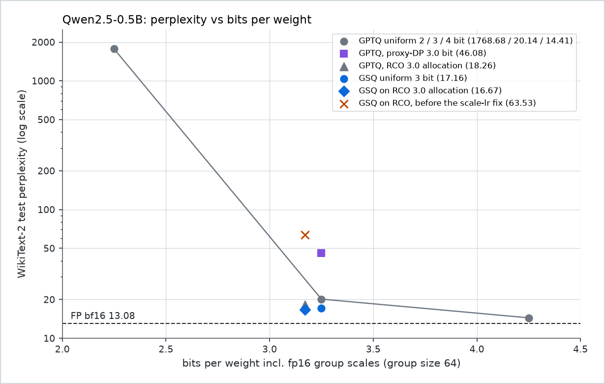

# GSQ and RCO on MLX: low-bit quantization of Qwen2.5-0.5B

This repository ports two quantization papers to Apple silicon with MLX. **GSQ** (Gumbel-Softmax scalar
quantization; Dadgarnia et al., [arXiv:2604.18556](https://arxiv.org/abs/2604.18556)) learns which grid point each
weight takes. **RCO** (Riemannian constrained optimization; Helcig and Alistarh,
[arXiv:2605.00649](https://arxiv.org/abs/2605.00649)) chooses each linear's bit-width under an exact average-bit
budget. See [Papers](#papers) for what each paper contributes and [Citation](#citation) to cite them. Both run on
Qwen2.5-0.5B on a 16 GiB M3, end to end, in about 2 h 36 min for one configuration.

Write-up: [Learned 3-Bit Codes on a Budget-Exact Allocation: GSQ and RCO on Apple Silicon](https://konic.io/research/gsq-rco-mixed-precision-mlx).

The first version of this port was wrong. Its own evaluation gave perplexity 1418 for the quantized model, against
25.54 for the bf16 model. A 2026-10-24 audit found the causes, and the fixes are merged into `main`. The [audit section](#the-audit) lists all 23 findings with their fix commits.

## Results

WikiText-2 test perplexity: 146 windows of 2,048 tokens, one run per row, seed 0. Full table, protocol and
sources: [docs/RESULTS.md](docs/RESULTS.md).

| Configuration | Perplexity | Bits/weight incl. fp16 scales | Code bits |
|---|---:|---:|---:|
| bf16 | 13.08 | 16 | 16 |
| GPTQ, uniform 3-bit | 20.14 | 3.25 | 3.00 |
| GPTQ, RCO 3.0-bit allocation | 18.26 | 3.17 | 2.92 |
| GSQ, uniform 3-bit | 17.16 | 3.25 | 3.00 |
| **GSQ on the RCO 3.0-bit allocation** | **16.67** | **3.17** | **2.92** |



GSQ on the RCO allocation is 27% above the bf16 perplexity. Uniform 3-bit GPTQ is 54% above it. Allocation alone
(GPTQ codes) gains 9%, and GSQ alone (uniform 3 bits) gains 15%. Together they gain 17%, not the sum, because the
two gains overlap. The RCO allocation decodes to 2.92 of its 3.00 bits, so the comparison is not iso-bit.
See [RESULTS section 5](docs/RESULTS.md#5-interpreting-the-comparisons) and [Limitations](#limitations).

## Quickstart

You need Apple silicon, Python 3.12, [uv](https://docs.astral.sh/uv/), the bf16 `Qwen/Qwen2.5-0.5B` checkpoint,
and about 2 h 36 min for the full pipeline. The model is not in the repository.

```bash
uv venv --python 3.12 .venv && source .venv/bin/activate
uv pip install -e ".[dev]"

# Put the checkpoint (model.safetensors, config.json, tokenizer files) in models/Qwen2.5-0.5B/
gsq-rco data                                                       # WikiText-2, downloaded once
gsq-rco run --run-dir results/runs/rco3 --avg-bits 3.0 --dry-run   # print the plan, run nothing
gsq-rco run --run-dir results/runs/rco3 --avg-bits 3.0             # build-db, allocate, quantize, export, eval
pytest -m "not slow"                                               # 33 tests, no model needed
```

`gsq-rco run` is resumable. Finished steps are skipped on a rerun. Each step is also its own command
(`build-db`, `allocate`, `quantize`, `export`, `eval`). The complete reference is in
[docs/CLI.md](docs/CLI.md), and the code map is in [docs/ARCHITECTURE.md](docs/ARCHITECTURE.md).

## What GSQ and RCO do

**GSQ** replaces rounding with learned assignments. A weight is a scale times a grid value, `w = s * q`, with
`q` on a grid of `2^b` levels (paper Eq. 5). Each weight carries logits over the grid. At 3 bits and above only
five neighbours of the rounded value are considered (local shift, Eq. 6). Gumbel-Softmax sampling,
`p = softmax((kappa * l + g) / tau)`, relaxes the choice. The temperature anneals from 2 to 0.05 and the sharpness
`kappa` from 100 to 500. Lion trains the logits and group scales to reproduce each block's output, starting from
a GPTQ solution. The result is ordinary scalar codes with group scales.

**RCO** chooses a bit-width for every linear under an exact average budget. With `p_i = softmax(alpha_i)`, the
expected cost is `C(alpha) = sum_i w_i <p_i, c>` (Eq. 1). Each step moves on the manifold `C(alpha) = B`: it
projects the gradient onto the tangent space, takes an Adam step, and retracts to the budget by binary search
(Prop. 3). The discrete choice is a Gumbel-perturbed multiple-choice knapsack solved exactly by DP, with a
straight-through gradient (Eq. 4). The objective is the mean token KL between the full model and the model
assembled from GPTQ residuals (Eq. 6). The allocation is therefore judged on the whole network, not per layer.

## The audit

The original port (commit `3aa06d8`) reported 1418.36 perplexity on quantized Qwen2.5-0.5B, against 25.54 for
the bf16 model. The evaluation was a 1,020-token custom text. The audit found that the pipeline applied each
quantized block twice. It also found that the allocation used a per-layer proxy instead of the RCO objective, that
GSQ training could not change most codes, and that the sensitivity forward expanded grouped-query attention
incorrectly. The rest of the findings are in the table. Code comments use the same numbering.

| | Before (`3aa06d8`) | After (`main`) |
|---|---|---|
| Evaluation text | text of the RCO paper, four 256-token windows (custom) | WikiText-2 test, 146 windows of 2,048 tokens |
| bf16 perplexity | 25.54 | 13.08 |
| Quantized perplexity | 1418.36 at 2.96 average bits | 16.67 at 2.92 code bits (3.17 with scales) |
| Ablation: six 2-bit layers kept bf16 | 44.25 | not run |

The two columns use different evaluations. They are shown for the audit trail and are not a like-for-like
improvement. The pre-audit record is in [RESULTS section 7](docs/RESULTS.md#7-before-the-audit).

<details>
<summary>All 23 findings, their status, and the fix commits</summary>

| # | Finding | Status | Fix commit(s) |
|---|---|---|---|
| 1 | The allocation was a per-layer MSE proxy with DP, not RCO | Fixed | `484c33f`, `ec8433d` |
| 2 | The sensitivity forward expanded GQA heads incorrectly and was non-causal | Fixed: module removed; forward checked against mlx-lm | `484c33f`, `05fe395` |
| 3 | GSQ training could not change assignments, only add init noise | Fixed: GPTQ start and staged training; median 4% of codes change at 2 to 4 bits | `3d3c483`, `b0f4617` |
| 4 | The pipeline applied every quantized block twice | Fixed: single-pass streams | `3d3c483` |
| 5 | The failure analysis ("model too small") was contradicted by the RTN results | Fixed: report replaced by [RESULTS](docs/RESULTS.md) | `62506a6` |
| 6 | No within-block staging | Fixed: `qk`, `vo`, `mlp` with the paper's losses | `3d3c483` |
| 7 | No GPTQ warm start | Fixed: GPTQ with signed scales | `b0f4617` |
| 8 | The allocation was scored with a different quantizer than the one deployed | Fixed: database built with the deployment quantizer | `484c33f` |
| 9 | The RCO loop mixed raw and per-layer-normalized sensitivities | Superseded: objective replaced | `484c33f` |
| 10 | First-token activations dominated the per-linear error | Fixed: position 0 excluded from losses and Hessians | `3d3c483`, `484c33f` |
| 11 | Non-standard data: calibration on the GSQ paper's text, evaluation on the RCO paper's text | Fixed: WikiText-2, GPTQ protocol | `05fe395` |
| 12 | Rounding on the integer grid dropped budget | Fixed: exact integer weights | `97181da` |
| 13 | The report's decoded average was wrong | Fixed: decoded from the integer cost | `97181da`, `484c33f` |
| 14 | Bit accounting omitted scales; no MLX export | Fixed: bit-packed mlx-lm export; honest bits/weight | `80352a1` |
| 15 | The two-option DP fast path solved the wrong problem | Fixed: exact DP; fast path checked against brute force | `97181da` |
| 16 | Positive-only scales clipped the grid's positive tail | Fixed: signed scales | `b0f4617` |
| 17 | Missing pieces: scale fine-tune, ternary path, scale learning rate | Fixed: App-H fine-tune implemented (not run); ternary path; scale rate 5e-5 | `3d3c483`, `b0f4617` |
| 18 | RCO settings: 24 groups, 4 options, T = 10, g = 4 | Fixed: 168 linears, 6 options, T = 100, g = 8 | `484c33f`, `ec8433d` |
| 19 | Resume and cache hazards | Fixed: resume replays the prefix; fingerprints; database identity | `3d3c483`, `484c33f`, `c6f55b1`, `b9e3305` |
| 20 | Weak tests: a test passed with lr = 0; a smoke test had no assertions | Fixed: assertions, forward reference test, pytest suite | `b0f4617`, `05fe395`, `b9e3305` |
| 21 | Docs claimed MSE/KL sensitivities and a reproduce command that ran a stub | Fixed: README, CLI and architecture rewritten | `b9e3305`, `62506a6` |
| 22 | Two inconsistent init functions | Fixed: one App-A init | `b0f4617` |
| 23 | Retraction did not check its bracket | Fixed: bracketed retraction that raises | `97181da` |
| A | Found while fixing: 8-bit linears crashed the stage optimiser at layer 3 | Fixed: 8-bit linears are GPTQ-only | `8df492a` |
| B | Found while fixing: group scales at 4 to 8 bits made Lion steps too large; the first GSQ run on the RCO allocation scored 63.53 | Fixed: scales frozen above 3 bits; with the fix, the same configuration scores 16.67 | `c6f55b1` |

</details>

## Hardware, memory and runtime

Measured on a 16 GiB M3 (`hw.memsize` 17,179,869,184 bytes), mlx 0.32.4, one step at a time:

| Step | Time | Peak memory |
|---|---:|---|
| `build-db` (168 linears, 6 options) | 9.3 min | 1.37 GiB footprint |
| `allocate` (100 RCO steps, g = 8) | 47.1 min | 2.33 GiB footprint |
| `quantize` (GSQ, 24 blocks) | 92.6 min (uniform 3); 97.1 min (RCO) | 2.5 to 2.9 GiB RSS; 3.12 GiB MLX peak |
| `eval` (WikiText-2 test) | about 2 min | 1.6 to 2.4 GiB footprint |

The full RCO pipeline takes about 2 h 36 min. The one-time data download is not timed in any log. `quantize` is the
heaviest step. Run one heavy step at a time. Details and sources: [RESULTS section 2](docs/RESULTS.md#2-what-one-3-bit-pipeline-costs)
and [CLI memory notes](docs/CLI.md#memory-and-time).

## Limitations

- **One model, one dataset, one seed.** Qwen2.5-0.5B on WikiText-2 test. No confidence intervals, and run-to-run
  spread is not measured. Differences of a few tenths of a perplexity point should not be read as established.
- **A smaller budget than the papers.** GSQ calibrates on 128 sequences of 512 tokens (paper: 4,096 of 4,096).
  It takes 200 steps per stage (paper: about 1,280 per block). It uses group size 64 (paper: 128) and micro-batch 2
  (paper: 64). The numbers are not comparable with the papers' tables.
- **Deliberate deviations.** Scales above 3 bits are frozen, following the paper's Table 9 treatment of GGUF
  K-quants. 8-bit linears are GPTQ-only. App H (end-to-end scale fine-tune) is implemented but not run in any
  reported result. The ternary (1-bit) path has unit tests but is not used in any reported result.
- **The RCO decode underspends.** The final DP-on-log-p decode gives 2.92 bits against a 3.00 target. The
  allocation comparison therefore favours RCO. See [RESULTS section 3](docs/RESULTS.md#3-the-allocation-rco-30-bit-budget).
- **Two comparisons are not controlled.** The allocation comparison is not iso-bit. The quantizer comparison is not
  iso-calibration: GSQ uses 65,536 calibration tokens, the GPTQ database 32,768.
- **GSQ is not bit-reproducible on the GPU.** The MLX GPU backward of `mx.take` is nondeterministic. The CPU device
  is deterministic. The reported GSQ numbers are single runs.
- **The checkpoint is not included.** Place `Qwen/Qwen2.5-0.5B` in `models/Qwen2.5-0.5B/` before running.

## Papers

This repository implements two papers. Neither is redistributed here; read them on arXiv.

- **GSQ: Highly-Accurate Low-Precision Scalar Quantization for LLMs via Gumbel-Softmax Sampling.** Dadgarnia,
  Tabesh, Nikdan, Helcig, Kurtić, Kleinegger and Alistarh, 2026. [arXiv:2604.18556](https://arxiv.org/abs/2604.18556).
  It relaxes each weight's choice of grid point into a Gumbel-Softmax distribution and trains the logits, block by
  block, against the full-precision layer outputs. This repository uses its Eq. 5/6 parametrisation, App. A
  initialisation, staged training with Lion (Table 7/9) and the App. H scale fine-tune (implemented, not run).
- **Model Compression with Exact Budget Constraints via Riemannian Manifolds.** Helcig and Alistarh, 2026.
  [arXiv:2605.00649](https://arxiv.org/abs/2605.00649). It optimises per-linear bit-width probabilities on the
  manifold where the expected cost equals the budget exactly, and decodes them with a multiple-choice knapsack DP.
  This repository uses its Riemannian Adam with binary-search retraction, the Gumbel straight-through estimator and
  the App. B full-model KL objective over a GPTQ database.

[docs/ARCHITECTURE.md](docs/ARCHITECTURE.md) maps each equation and algorithm to the code.

## Citation

This is an independent implementation. If you use it, please cite the two papers:

```bibtex
@article{dadgarnia2026gsq,
  title   = {{GSQ}: Highly-Accurate Low-Precision Scalar Quantization for {LLMs} via Gumbel-Softmax Sampling},
  author  = {Dadgarnia, Alireza and Tabesh, Soroush and Nikdan, Mahdi and Helcig, Michael and
             Kurti{\'c}, Eldar and Kleinegger, Maximilian and Alistarh, Dan},
  journal = {arXiv preprint arXiv:2604.18556},
  year    = {2026}
}

@article{helcig2026rco,
  title   = {Model Compression with Exact Budget Constraints via {Riemannian} Manifolds},
  author  = {Helcig, Michael and Alistarh, Dan},
  journal = {arXiv preprint arXiv:2605.00649},
  year    = {2026}
}
```

## Repository layout

```text
src/gsq_rco/    the package: common/ (data, model, evaluation), gsq/ (quantizer, staged optimiser, export),
                rco/ (manifold, loop, database, allocation), cli.py, run.py
tests/          pytest suite; `-m "not slow"` needs no model, `-m slow` loads the checkpoint
docs/           CLI.md, ARCHITECTURE.md, RESULTS.md, figures/
results/        committed run records: rco_allocation.json and results/runs/*. Caches and the
                exported checkpoints are git-ignored and regenerated by the commands
```

Documentation: [CLI reference](docs/CLI.md) · [architecture and paper-to-code map](docs/ARCHITECTURE.md) ·
[results, protocol and reproduction](docs/RESULTS.md).
