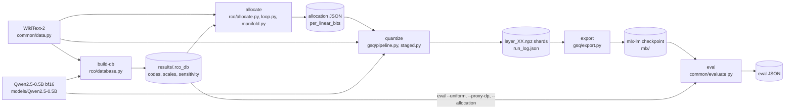

# Architecture

One Python package, `gsq_rco`, holds both algorithms, the shared data and evaluation code, and the
`gsq-rco` command line. Back to the [README](../README.md). Commands are in [CLI.md](CLI.md), and the
numbers are in [RESULTS.md](RESULTS.md).

The two papers are the references for the code. Their text extractions are tracked at the repository root:

- **GSQ**, [`gsq.txt`](../gsq.txt): Dadgarnia et al., "GSQ: Highly-Accurate Low-Precision Scalar Quantization
  for LLMs via Gumbel-Softmax Sampling".
- **RCO**, [`rco.txt`](../rco.txt): Helcig and Alistarh, "Model Compression with Exact Budget Constraints via
  Riemannian Manifolds".

## Package map

```text
src/gsq_rco/
  cli.py             argument parsing and dispatch for the seven commands
  run.py             gsq-rco run: step plan, chained config hashes, skip and resume
  common/
    data.py          WikiText-2 loading, tokenization, calibration and evaluation windows
    model.py         bf16 Qwen2 loading, linear addressing, weight swapping
    evaluate.py      chunked NLL and KL through the tied LM head; evaluate_mlx_model (mlx_lm.load)
  gsq/
    quant.py         grids (Eq. 5), local shift (Eq. 6), tau and kappa schedules
    gptq.py          RTN, GPTQ (Sec. 3.1), the App-A logit inits
    lion.py          Lion update (App G) and the group-scale rule scale_lr
    e2e.py           lazy safetensors reader and the one-sequence Qwen2 stream
    staged.py        block-wise staged optimiser: qk, vo, mlp; App-H scale fine-tune
    pipeline.py      run_quantize: block loop, shards, resume, sanity perplexity, export
    export.py        bit packing, MLX affine format, mlx-lm checkpoint writer
  rco/
    manifold.py      expected cost, normal, tangent projection, retraction, transport, DP knapsack
    loop.py          RCO loop (Alg. 1): Gumbel perturbation, DP solve, STE, Adam step, retraction
    database.py      the GPTQ database of per-linear, per-option quantizations; Hessians; manifest
    allocate.py      KL objective (Eq. 6), exact budget grid, allocation, baselines
    driver.py        the build-db, allocate and eval command bodies
```

Tests live in `tests/` (pytest). Five tests load the real checkpoint or run a full model pass and carry
`@pytest.mark.slow`: `test_common::test_real_model`, `test_export::test_export_full_model`,
`test_forward_reference::test_forward_reference`, `test_gptq::test_gptq` and `test_gsq_pipeline::test_gsq_pipeline`.

| Test file | What it checks |
|---|---|
| `test_cli.py` | Every subcommand parses and has examples in its help |
| `test_common.py` | Data windows, NLL and KL against references (the real-model test is slow) |
| `test_forward_reference.py` | Block forwards against the mlx-lm model on a real window (slow) |
| `test_gptq.py` | Signed-scale RTN and GPTQ error against RTN (fast); the real-layer GPTQ test is slow |
| `test_gsq_phase1.py` | GSQ grid, schedules and soft-to-hard collapse on synthetic weights |
| `test_gsq_pipeline.py` | Staged optimiser on toy blocks (fast); the pipeline test on the checkpoint is slow |
| `test_export.py` | Packing against `mx.quantize` for every width (fast); the full-model export is slow |
| `test_rco_phase1.py` | Retraction, tangent projection, DP against brute force, loop on synthetic logits |
| `test_rco_alloc.py` | STE against finite differences, KL = 0 at the reference, database round trip and staleness |
| `test_run.py` | The step plan, chained hashes, skip and run decisions, database reuse |
| `test_smoke.py` | Assertions on the GSQ and RCO primitives, under 5 s |

Fast suite (no model): `pytest -m "not slow"` (33 tests). Slow suite: `pytest -m slow` (5 tests).

## Data flow



`gsq-rco run` executes the five steps in order and records each one (see [CLI.md](CLI.md#run)). The
individual commands run any step alone.

Two consumers read the database. `eval --uniform`, `--proxy-dp` and `--allocation` evaluate GPTQ codes
directly, without GSQ training. The GSQ path (`quantize`, then `export` and `eval --mlx-model`) reads the
allocation and the calibration stream, and writes its own shards.

## Paper-to-code map

### GSQ (`gsq.txt`)

| Paper | Content | Code |
|---|---|---|
| Sec. 3.1 | GPTQ warm start (Hessian-based error compensation) | `gsq/gptq.py`: `quantize_gptq` (damp, block size 128, signed scales), `hessian_from_inputs` |
| Sec. 3.2, Eq. (5) | Grid `G_b` with `2^b` values; weight `w = s * q` | `gsq/quant.py`: `get_grid` |
| Sec. 3.2, Eq. (6) | Local shift: 5 logits per weight, `delta` in {-2..2}, index clipped to the grid | `gsq/quant.py`: `local_shift_indices`, `local_shift_values`; `gsq/staged.py`: `_shift_rows` |
| Alg. 1 | Gumbel-Softmax `p = softmax((kappa * l + g) / tau)` | `gsq/staged.py`: `_gs_softmax`, `_gumbel` |
| Alg. 2 | Ternary: mask and sign, two binary Gumbel-Softmax draws | `gsq/staged.py`: `_binary_gs`, `_ternary_rows` |
| App. A | Logit initialization from GPTQ codes (`alpha = 6` for 2 to 7 bits, 3 for ternary) | `gsq/gptq.py`: `init_logits_2bit_from_codes`, `init_shift_logits`, `init_ternary_logits` |
| Sec. 3.3, 4.1, App. C | Block-wise staged training, each block applied once per stream | `gsq/staged.py`: `STAGES`, `quantize_block`, `_train`, `_loss_linear`, `_loss_attn`, `_loss_block`; `gsq/pipeline.py`: `run_quantize` |
| App. G, Table 7 | Lion; logit lr 1e-4, scale lr 5e-5, weight decay 1.0, betas (0.9, 0.95); tau 2 to 0.05, kappa 100 to 500 | `gsq/lion.py`: `lion_update`, `scale_lr`; `gsq/quant.py`: `gs_schedules` |
| App. H | End-to-end scale-only fine-tune with the codes fixed | `gsq/staged.py`: `scale_finetune` (called from `pipeline.py` when `--scale-finetune-steps` > 0) |

Stage losses (`staged.py` docstring):

| Stage | Linears | Loss | Hardened during the stage |
|---|---|---|---|
| `qk` | `q_proj`, `k_proj` | per-linear reconstruction, `\|\|X (W_bar - W)^T\|\|^2` | none |
| `vo` | `v_proj`, `o_proj` | self-attention output, `\|\|A_bar(x) - A(x)\|\|^2` | `q`, `k` |
| `mlp` | `gate_proj`, `up_proj`, `down_proj` | block output, `\|\|Y_bar(x) - Y(x)\|\|^2` | attention |

Within a stage, each linear gets a GPTQ warm start. Its Hessian comes from its real input: the stream with all
earlier stages hardened, and the earlier linears of this stage at their GPTQ values. Then the logits and scales
are trained with Lion and hardened to argmax codes. Scales are rounded to fp16, which is the stored form.

### RCO (`rco.txt`)

| Paper | Content | Code |
|---|---|---|
| Eq. (1) | Expected cost `C(alpha) = sum_i w_i <p_i, c>`, `p_i = softmax(alpha_i)` | `rco/manifold.py`: `softmax`, `expected_cost` |
| Eq. (2) | Normal `(grad C)_ik = w_i p_ik (c_k - E[c])` | `rco/manifold.py`: `normal_vector` |
| Alg. 1 (tangent step), Prop. 6 | Project the gradient onto the tangent plane, which removes the STE bias along the normal | `rco/manifold.py`: `project_tangent` |
| Prop. 3 | Retraction: binary search on the monotone `C(t)` to the budget | `rco/manifold.py`: `retract` (tolerance `RETRACT_TOL` = 1e-8 in float64) |
| Alg. 1 (transport) | Parallel transport of the first Adam moment | `rco/manifold.py`: `transport` |
| Eq. (4) | DP solve: maximize `sum z * alpha_hat` subject to the budget, one option per group | `rco/manifold.py`: `dp_knapsack`, `_mckp_dp`; `topk_2option` (two-option fast path) |
| Alg. 1 | Gumbel perturbation `alpha_hat = (alpha + G) / tau`, DP solve, STE on the same perturbed logits, Adam step, retraction, transport; `tau` exponential 1.0 to 0.01 | `rco/loop.py`: `rco_loop`, `sample_gumbel`, `perturbed_logits`, `soft_probs`, `ste_grad`, `tau_schedule` |
| Eq. (6), App. B | Mean token KL `KL(p_ref \|\| p_z)` of the assembled model; linear `i` is `W_ref + sum_k z_ik Delta_ik` | `rco/allocate.py`: `KLObjective`; `rco/database.py`: `build_database`, `Database`; `common/evaluate.py`: `kl_value_and_grad_hidden` |
| App. B (integer units) | DP costs and the budget in integer units, bitwidths scaled by parameter fraction | `rco/allocate.py`: `budget_grid`; `rco/loop.py`: `integer_weights`, `to_int_grid` |
| App. B.1 | DP knapsack and the O(N log N) top-k path for two options | `rco/manifold.py`: `dp_knapsack`, `topk_2option` |
| Alg. 1, final | Final assignment is DP on `log p` with no noise | `rco/loop.py`: `rco_loop` (`z_final`); `rco/allocate.py`: `rco_allocate`, `decoded_cost` |

Recommended settings (rco.txt, Table 24) and the values used here:

| Setting | Table 24 | Used | Note |
|---|---|---|---|
| Gumbel samples `g` | 16 to 32 (robust 4 to 64) | 8 | Time: 28 s per step on this machine |
| Steps `T` | 50 to 200 | 100 | |
| Minimum temperature | 0.01 (0.005 to 0.05) | 0.01 | |
| Learning rate | 0.1 (0.05 to 0.2) | 0.1 | |
| Calibration | 256 sequences (128 to 512) | 16 windows of 512 tokens | Time and memory |
| Layer grouping | none | none (168 per-linear groups) | |

## Deviations from the papers

| Item | Paper | Here | Why |
|---|---|---|---|
| GSQ calibration | 4,096 sequences of 4,096 tokens | 128 of 512 | Time and memory on a 16 GiB machine |
| GSQ steps | about 1,280 per block (20 epochs, batch 64) | 200 Lion steps per stage | Time: 93 to 97 min per model |
| GSQ group size | 128 (Table 7) | 64 | Matches the GPTQ database |
| GSQ micro-batch | 64 | 2 calibration sequences per step | Memory |
| Scale rate above 3 bits | 5e-5 (Table 7); Table 9 uses 0 for GGUF Q3/4/5_K | 0 above 3 bits | Layer-3 failure, RESULTS section 6 |
| 8-bit linears | local shift (5 logits per weight) at 3 bits and above (Sec. 3.2) | GPTQ codes and scales only, frozen by the stage optimiser | 256 logits per weight are out of budget (`staged.py` docstring) |
| App. H scale fine-tune | 2-bit Llama only | implemented, off by default | Not run for any reported result |

The GSQ paper's staging (Sec. 4.1) is implemented as written. The joint `vo` and `mlp` losses are not
replaced by per-linear losses.

One implementation choice goes beyond the table: position 0 of every window is excluded from the losses and
the Hessians. The motivation is the massive first-token activations (audit finding 10).

## Numerics and determinism

- The RCO manifold runs in float64 (numpy). The model forward and the KL gradient run in MLX on bf16 weights.
- The stage optimiser keeps the logits and Lion state in float32 and runs the block forward in bf16
  (`staged.py` docstrings). GPTQ runs in float64 numpy. Shards store codes as uint8 and scales as fp16. The MLX export stores scales and biases as bf16 (`gsq/export.py` docstring; the error is bf16 rounding
  of the scale, relative 2^-8).
- The MLX GPU backward of `mx.take`, used in the GSQ soft-weight gather, is nondeterministic. The CPU device
  is deterministic. The `mx.take` call is kept, with the reason noted in `gsq/staged.py`.
- Lion's sign update moves each parameter by about the learning rate per step. This is the reason for the
  scale rule in `gsq/lion.py` (section 6 of RESULTS).

## Audit traceability

Code comments refer to audit findings by number, for example "finding #10" in `gsq/staged.py` and
`rco/database.py`, and "audit finding 2" in `tests/test_forward_reference.py`. The numbering and the status of
each finding are in the [README](../README.md#the-audit). Commit SHAs in the README are the fixes.
