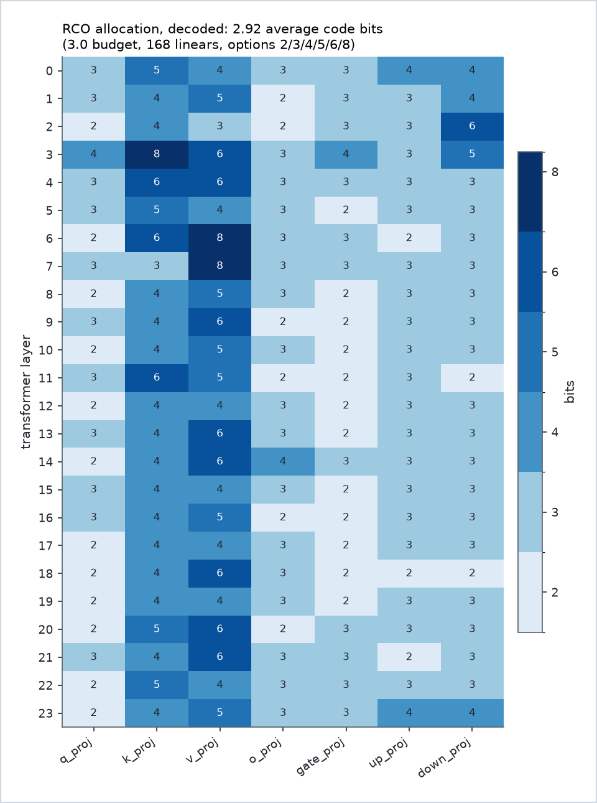
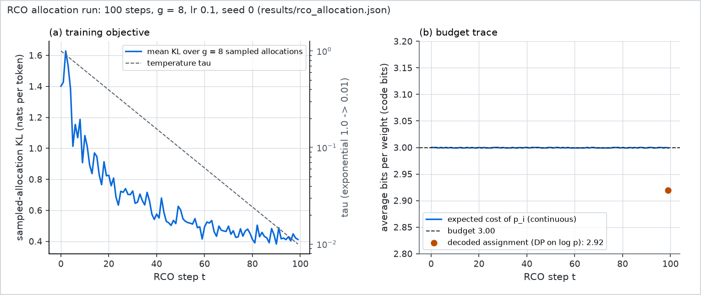

# Results: Qwen2.5-0.5B on WikiText-2

Every number below is read from a run record in `results/` (named under each table) or from the
git history. Nothing is estimated. Back to the [README](../README.md).

## Protocol

| Item | Setting | Source |
|---|---|---|
| Model | Qwen2.5-0.5B, bf16, 24 layers, tied embeddings; 168 quantized linears holding 357,826,560 weights | `models/Qwen2.5-0.5B/config.json`, `results/rco_allocation.json` (`per_layer`) |
| Evaluation | WikiText-2 raw v1 test split, Qwen2.5 tokenizer, no BOS; 146 non-overlapping windows of 2,048 tokens; 298,862 scored next-token targets | `results/runs/eval_gptqdb_fp.json`; `gsq-rco data` |
| Perplexity | `exp(mean next-token NLL)` over the scored targets | `src/gsq_rco/common/evaluate.py` |
| GPTQ database | 6 options (2, 3, 4, 5, 6, 8 bits), group size 64, damp 0.01, 16 train windows of 2,048 tokens (32,752 Hessian rows after dropping position 0) | `results/rco_allocation.json` (`database`) |
| RCO objective | Mean token KL from the FP model to the assembled model, on 16 train windows of 512 tokens (seed 1) | `results/rco_allocation.json` (`config`) |
| GSQ calibration | 128 train windows of 512 tokens (65,536 tokens; seed 0), 200 Lion steps per stage | `results/runs/gsq_rco3/run_log.json` (`config`) |
| Software | mlx 0.32.4, mlx-lm 0.32.2, numpy 2.5.4, Python 3.12 | the project venv |
| Machine | Apple M3, 16 GiB unified memory (`hw.memsize` 17,179,869,184 bytes) | `sysctl` |
| Units | Memory in GiB (2^30 bytes); "footprint" is the macOS peak memory footprint from `/usr/bin/time -l`; bits/weight incl. scales = code bits + 16/64 for an fp16 scale per 64 weights | |

Each configuration is one run (seed 0). No run-to-run variance was measured (see Limitations).

## 1. Perplexity and bit accounting

| Configuration (record) | WikiText-2 ppl | Code bits | Bits/weight incl. fp16 scales | MLX file | Eval time | Peak footprint |
|---|---:|---:|---:|---:|---:|---:|
| bf16 base (`eval_gptqdb_fp.json`) | 13.08 | 16 (bf16) | 16 | 988.1 MB (base checkpoint) | 123.0 s | 1.76 GiB |
| GPTQ uniform 2 (`eval_gptqdb_u2.json`) | 1768.68 | 2.00 | 2.25 | — | 124.7 s | 2.35 GiB |
| GPTQ uniform 3 (`eval_gptqdb_u3.json`) | 20.14 | 3.00 | 3.25 | — | 124.2 s | 2.33 GiB |
| GPTQ uniform 4 (`eval_gptqdb_u4.json`) | 14.41 | 4.00 | 4.25 | — | 125.0 s | 2.33 GiB |
| GPTQ, proxy-DP 3.0 (`eval_gptqdb_proxy3.json`) | 46.08 | 3.00 | 3.25 | — | 123.1 s | 2.38 GiB |
| GPTQ, RCO 3.0 allocation (`eval_gptqdb_rco3.json`) | 18.26 | 2.92 | 3.17 | — | 140.0 s | 2.33 GiB |
| GSQ uniform 3 (`eval_gsq_u3.json`, `gsq_u3/run_log.json`) | 17.16 | 3.00 | 3.25 | 429.0 MB | 125.1 s | 1.61 GiB |
| **GSQ on RCO 3.0 (`eval_gsq_rco3.json`, `gsq_rco3/run_log.json`)** | **16.67** | **2.92** | **3.17** | **425.4 MB** | **127.2 s** | **1.61 GiB** |
| GSQ on RCO 3.0, before the scale-lr fix (`gsq_rco3_oldrule/eval_gsq_rco3.json`), see section 6 | 63.53 | 2.92 | 3.17 | 425.4 MB (as recorded) | 124.0 s | 1.61 GiB |

Sources: `results/runs/eval_*.json` (`ppl`, `decoded_avg_bits`, `bpp_avg_incl_scales`, `seconds`,
`file_bytes`); `results/runs/*/run_log.json` (`export.bits_per_weight`: `code_bpp` and `native_bpp`);
`results/runs/*.log` (footprint from `/usr/bin/time -l`).

- The GPTQ rows report code bits and bits/weight directly from the eval records. GSQ rows take them from
  the run log export block. The GSQ and GPTQ bits/weight agree (3.25 for uniform 3 bits, 3.17 for the RCO
  allocation), so the rows are comparable on the same footing.
- MLX file size is the sum of the `.safetensors` files in the export directory. In the MLX format the
  scales and biases are bf16, so the MLX bits/weight are 3.50 (uniform 3) and 3.42 (RCO allocation). The
  file is dominated by the bf16 tied embedding: 272.3 MB of the 425.4 MB in the RCO export (64%), and the
  packed linear codes are 130.6 MB (`safetensors` header of `results/runs/gsq_rco3/mlx/model.safetensors`).
- "—" means no MLX checkpoint was written for that row, so no file size exists. The GPTQ evaluations score
  the database directly and write no checkpoint.

## 2. What one 3-bit pipeline costs

| Step (command) | Time | Peak memory | Source |
|---|---:|---|---|
| `build-db` (168 linears x 6 options) | 556.7 s | footprint 1.37 GiB, max RSS 1.26 GiB | `results/runs/build_db_gptq.log` |
| `allocate` (100 RCO steps, g = 8) | 2,825.1 s (28.2 s per step) | footprint 2.33 GiB, max RSS 1.16 GiB | `results/rco_allocation.json` (`timing`), `results/runs/rco_allocate_3bit.log` |
| `quantize --alloc` (GSQ, 24 blocks, export included) | 5,824.6 s (97.1 min) | max RSS 2.86 GiB, peak MLX 3.12 GiB | `results/runs/gsq_rco3/run_log.json`, `gsq_rco3/run.log` |
| `eval --mlx-model` | 127.2 s | footprint 1.61 GiB | `results/runs/eval_gsq_rco3.json`, `.log` |
| **Total, RCO path** | **about 2 h 36 min** (155.6 min, excluding the one-time data download) | | |

The uniform-3 GSQ path needs no database or allocation: `quantize --uniform-bits 3` took 5,558.3 s (92.6 min),
with max RSS 2.49 GiB and peak MLX 3.12 GiB (`results/runs/gsq_u3/run_log.json`, `gsq_u3/run.log`).
The data download is not timed in any log. A cached `gsq-rco data` run takes 0.13 s (measured while
writing these docs).

GSQ's peak MLX memory of 3.12 GiB is above the 1.5 GB per-process target used while developing the
code. The 16 GiB machine ran each step alone. [CLI.md](CLI.md#memory-and-time) lists the memory knobs, none of which were measured in these runs.

Two process-level notes. The `build-db` and `allocate` memory figures come from the
`/usr/bin/time -l` blocks in the logs. The `build-db` per-layer lines print decimal GB and the GSQ
lines print GiB; the values here are converted to GiB from the byte counts.

## 3. The allocation (RCO, 3.0-bit budget)

Source: `results/rco_allocation.json`. Figures: [`figures/rco_allocation.png`](figures/rco_allocation.png),
[`figures/rco_trace.png`](figures/rco_trace.png).

- **Budget.** Average 3.00 bits over 3,120 units of 114,688 weights (exact integer grid; every linear size
  is a multiple of 114,688). The budget is 9,360 units. The continuous expected cost stays at 9,360 in every
  step (`max_abs_budget_gap` 9.7e-9, tolerance 1e-4).
- **Decoded assignment.** 9,110 units, which is **2.92 code bits** (3.17 incl. scales). The final decode is
  DP on log p with no noise (RCO paper, Alg. 1). It need not spend the whole budget, so the decoded average is
  0.08 bits under the target.
- **Histogram** (`per_linear_bits`, 168 linears): 2 bits: 35; 3 bits: 77; 4 bits: 30; 5 bits: 11; 6 bits:
  12; 8 bits: 3 (`3.k_proj`, `6.v_proj`, `7.v_proj`).
- **Objective trace.** Mean KL over the g = 8 sampled allocations falls from 1.40 (step 0) to 0.41 (step 99),
  with a minimum of 0.38 at step 90. The trace is the sampled objective, not the KL of the decoded
  assignment, which was not logged. Its quality is judged by perplexity only.
- **Settings.** T = 100, g = 8, lr 0.1, tau 1.0 to 0.01 (exponential), init zero, seed 0.

Baseline at the same nominal budget: the proxy-DP allocation (DP on the GPTQ output-MSE sensitivities,
`eval_gptqdb_proxy3.json`) decodes to exactly 3.00 bits and scores 46.08. The RCO allocation decodes to
2.92 bits and scores 18.26.

## 4. The quantizer (GSQ)

Source: `results/runs/gsq_u3/run_log.json`, `results/runs/gsq_rco3/run_log.json` (per stage and per
linear). Stage objective: the hard reconstruction error of the stage's loss, from the GPTQ init to the
hardened codes.

| Quantity | Uniform 3 bits | RCO allocation | Pre-fix run |
|---|---:|---:|---:|
| Stages whose objective fell (of 72) | 71 | 72 | 68 |
| Median final/init objective, `qk` / `vo` / `mlp` | 0.895 / 0.585 / 0.799 | 0.871 / 0.855 / 0.738 | 0.876 / 0.817 / 0.747 |
| Largest final/init objective, any stage | 1.696 (`mlp`, layer 3) | 0.981 (`vo`, layer 22) | 3.972 (`mlp`, layer 3) |
| Median fraction of codes changed from GPTQ, by bits | 3-bit: 4.1% | 2-bit: 3.7%, 3-bit: 4.3%, 4-bit: 3.7%, 5-bit: 7.6%, 6-bit: 9.8% | 2-bit: 3.6%, 3-bit: 4.4%, 4-bit: 4.0%, 5-bit: 7.2%, 6-bit: 7.9% |

Notes on the table:

- The largest-stage row is the maximum of `objective_final / objective_init` over all stages. A value
  below 1 means that stage fell. The RCO run has no stage above 1. The uniform-3 run has one: layer 3's
  `mlp` stage ends 1.70x above its init. The scale rule applies only above 3 bits, so uniform 3 bits is not
  affected by it, and this is not the scale-lr failure of section 6. It was not investigated further.
- The stage losses are the paper's. `qk` is a per-linear reconstruction, `vo` is the self-attention output
  error with q and k hardened, and `mlp` is the block output error with attention hardened (`staged.py`
  docstring; paper Sec. 4.1). For `vo` and `mlp` the loss is joint over several linears. Per-linear
  weight-space error therefore need not fall. In the RCO run, the H-weighted error of each linear, relative
  to its GPTQ init, has a median of 0.91 for `qk` (47 of 47 below 1), 1.50 for `vo` (3 of 46 below 1) and 1.64
  for `mlp` (0 of 72 below 1). The per-linear diagnostic is not a quality measure for `vo` and `mlp`.
- Sanity perplexity on two validation windows of 512 tokens (`sanity` in the run logs; not the reported
  metric): bf16 8.95, uniform 3 bits 11.54, RCO allocation 12.31.

## 5. Interpreting the comparisons

Each row of the table changes one factor and holds the other fixed. The first three rows compare against the
same uniform 3-bit GPTQ reference. The last two use the RCO allocation or GSQ as the fixed factor.

| Comparison | Change in ppl | Relative |
|---|---:|---:|
| Allocation (GPTQ codes): uniform 3 bits (20.14) to RCO 3.0 (18.26) | -1.88 | -9.3% |
| Quantizer (uniform 3 bits): GPTQ (20.14) to GSQ (17.16) | -2.97 | -14.8% |
| Combined: GPTQ uniform 3 bits (20.14) to GSQ on RCO (16.67) | -3.46 | -17.2% |
| Quantizer on the RCO allocation: GPTQ (18.26) to GSQ (16.67) | -1.58 | -8.7% |
| Allocation under GSQ: GSQ uniform 3 bits (17.16) to GSQ on RCO (16.67) | -0.49 | -2.9% |

Reading the table:

- **The two effects overlap.** The sum of the two separate effects is -4.85 ppl, but the combined effect is
  -3.46. Each method's gain is smaller in the presence of the other. Allocation helps less once the codes are
  trained (-0.49 vs -1.88), and training helps less on the RCO allocation (-1.58 vs -2.97).
- **The allocation comparison is not iso-bit.** The RCO allocation decodes to 2.92 bits and the uniform
  baselines to 3.00. This favours RCO. An iso-bit comparison would need a decode that spends the full budget,
  which the current decode does not do.
- **The quantizer comparison is not iso-calibration.** GSQ uses 65,536 calibration tokens (128 x 512). The
  GPTQ database uses 32,768 (16 x 2,048). Some of the quantizer effect may come from the larger calibration
  set rather than from the training.
- **Single runs.** No variance is estimated, so differences of a few tenths of a perplexity point should not
  be read as established. The GSQ GPU path is not bit-reproducible (Limitations).

Against the papers, qualitatively:

- The RCO paper reports RCO ahead of per-layer baselines that use a linear surrogate solved by DP (dynamic
  HIGGS) at fixed budgets (RCO paper, Table 2; those results are on other models). Here the proxy-DP allocation
  scores 46.08 at 3.00 bits and the KL-trained RCO allocation scores 18.26 at 2.92 bits. The ordering agrees
  with the paper on this model. It is one model and one seed, and the two allocations differ by 0.08 bits.
- The GSQ paper reports its results at a much larger scale than was run here. Its Llama runs use 20 epochs
  over 4,096 sequences of 4,096 tokens, batch size 64, and group size 128 (GSQ paper, Table 7). That is about
  1,280 optimizer steps per block. This implementation uses 128 sequences of 512 tokens, 200 steps per stage,
  group size 64 and micro-batch 2. The numbers are not comparable with the paper's tables.

## 6. Failure found and fixed: scale learning rate at 4 to 8 bits

The first GSQ run on the RCO allocation scored 63.53 (`gsq_rco3_oldrule/eval_gsq_rco3.json`). The
fix in commit `c6f55b1` freezes the group scales of linears above 3 bits in the stage optimiser. The
same run with the fix scores 16.67. The mechanism, from the `lion.py` docstring and the `c6f55b1` message:

- Lion's sign update moves each group scale by about the learning rate per step, in absolute terms.
- A b-bit GPTQ scale is max|w| / 2^(b-1), so scales shrink by about 2x per extra bit. The paper's scale
  rate (5e-5, Table 7) was set for 2/3-bit grids. At 4 to 8 bits the same absolute step is a large relative
  change.
- On real layer 3, the mlp-stage objective rose 3.97x over its GPTQ init at the old rate. With the rule it
  fell (0.31x in that measurement), and the qk and vo stages also fell (`c6f55b1` message).
- The run log agrees. Across the model, 4 of the 72 stages in the old run ended above their init, and none in
  the fixed run. The largest is layer 3's `mlp` stage at 3.97, the same stage the commit message reports.

The comparison is clean. Both runs use the same allocation (`allocation_used.json` is byte-identical to
`rco_allocation.json`) and the same run config (`run_log.json`, all keys equal). The only code difference
is the scale rule (commit `c6f55b1`, which touched `lion.py` and `staged.py`).

Provenance notes for the pre-fix run:

- Its records (`eval_gsq_rco3.json`, `run_log.json`) name `results/runs/gsq_rco3/mlx` as the export
  directory. That directory now holds the fixed run's checkpoint. The pre-fix run's own directory is
  `gsq_rco3_oldrule/`, and its checkpoint is `gsq_rco3_oldrule/mlx/model.safetensors`. That file differs
  byte-for-byte from `gsq_rco3/mlx/model.safetensors`. The directory appears to have been renamed after the
  evaluation, so the recorded path is stale. The file size and peak MLX memory match the fixed run because the
  bit widths and shapes are the same.
- It crashed at layer 3 on an 8-bit linear (`KeyError: 'k_proj.logits'`, fixed in `8df492a`) and was resumed
  (`run_crashed.log`). Layers 0 to 2 were written at 15:13 to 15:21, before the commit `8df492a` (15:43), and
  they contain no 8-bit linear.
- Its `seconds_total` (4,583.1 s) is smaller than the per-layer times summed (5,189.6 s). This suggests it
  covers only the resumed invocation.

## 7. Before the audit

The original port (commit `3aa06d8`, on `main`) recorded the following in `results/gsq_eval.json`. That
file is deleted in this change. Its content is available with `git show 3aa06d8:results/gsq_eval.json`.

| Quantity | Value | Notes |
|---|---:|---|
| bf16 perplexity | 25.54 | custom eval: four 256-token windows of the RCO paper's text (1,020 scored tokens) |
| Quantized perplexity | 1418.36 | 8 x 256-token calibration from the GSQ paper's text; 20 Lion steps per linear |
| Ablation: six 2-bit layers kept bf16 | 44.25 | same file (`ablation_34bit_only_ppl`) |

These numbers are not comparable with the table in section 1. They use a different evaluation text, a different
calibration set and the pipeline's double-application bug. The audit (finding 4 in the README's
audit table) reproduced 1418.36 exactly by applying each quantized block twice; the audit scripts are not in the repository.

## 8. Limitations

- **One model, one dataset, one seed.** Qwen2.5-0.5B on WikiText-2 test. No confidence intervals. The 0.5B
  model is small, and results at this scale may not carry over to larger models.
- **Reduced budget against the papers.** Calibration, steps and group size are all smaller than in the
  papers (section 5). Micro-batch is 2 against 64.
- **Scale training is frozen above 3 bits.** This follows Table 9 of the GSQ paper, which uses a scale rate
  of 0 for the GGUF Q3/4/5_K rows. It is a deviation from the Table 7 setting for those bit widths.
- **8-bit linears are GPTQ-only.** Their codes and scales are not trained in the stage optimiser. App H
  (scale-only fine-tune), when enabled, still changes their scales.
- **App H is implemented but not run.** `scale_finetune_steps` is 0 in every reported run.
- **Ternary (1-bit) is implemented but not used.** No reported result uses it. It has unit tests and toy-scale
  checks only.
- **The RCO decode underspends.** 2.92 of 3.00 bits (section 3). A budget-tight decode would change the
  comparison in section 5.
- **GSQ is not bit-reproducible on the GPU.** The MLX GPU backward of `mx.take` is nondeterministic. In a
  development measurement, two identical GPU runs differed in about 21% of one layer's `gate_proj` codes. The
  CPU device is deterministic. Reported GSQ numbers are single runs. Run-to-run spread is unmeasured.
- **Calibration confound.** The GSQ and GPTQ-database calibration sets differ in size (section 5).
- **Memory.** GSQ `quantize` peaks at 3.12 GiB MLX and 2.5 to 2.9 GiB max RSS per process (section 2).
- **Records were made step by step.** The committed run directories have no `steps/` records, so they were
  not produced by `gsq-rco run`. The `run` wrapper runs the same steps with the same defaults.
- **Unexplained timing.** The RCO-allocation GPTQ evaluation took 140 s, against 123 to 125 s for the other
  GPTQ evaluations. It was not investigated.
- **Git-ignored artifacts.** `results/.rco_db` (2.1 GB), `results/.gsq_cache/`, `results/runs/*/mlx/` and the
  shards are not committed. They are regenerated with the commands in section 9.

## 9. Reproduce

These commands correspond to the committed records. Every setting matches the recorded config (see the
run logs and `rco_allocation.json`). They need the model in `models/Qwen2.5-0.5B/` and about 2 h 36 min. Run
them from the repository root, one at a time, on a 16 GiB machine.

```bash
gsq-rco data                                                    # WikiText-2, cached after the first run
gsq-rco eval --fp --out results/runs/eval_gptqdb_fp.json

gsq-rco build-db --db results/.rco_db                           # ~9 min, 1.4 GiB footprint
gsq-rco eval --uniform 2 --db results/.rco_db --out results/runs/eval_gptqdb_u2.json
gsq-rco eval --uniform 3 --db results/.rco_db --out results/runs/eval_gptqdb_u3.json
gsq-rco eval --uniform 4 --db results/.rco_db --out results/runs/eval_gptqdb_u4.json
gsq-rco eval --proxy-dp --avg-bits 3.0 --db results/.rco_db --out results/runs/eval_gptqdb_proxy3.json

gsq-rco allocate --db results/.rco_db --avg-bits 3.0 --out results/rco_allocation.json   # ~47 min
gsq-rco eval --allocation results/rco_allocation.json --db results/.rco_db --out results/runs/eval_gptqdb_rco3.json

gsq-rco quantize --uniform-bits 3 --out results/runs/gsq_u3    # ~93 min
gsq-rco eval --mlx-model results/runs/gsq_u3/mlx --out results/runs/eval_gsq_u3.json

gsq-rco quantize --alloc results/rco_allocation.json --out results/runs/gsq_rco3   # ~97 min
gsq-rco eval --mlx-model results/runs/gsq_rco3/mlx --out results/runs/eval_gsq_rco3.json
```

The RCO path (build-db, allocate, quantize, export, eval) runs as one resumable command:
`gsq-rco run --run-dir results/runs/rco3 --avg-bits 3.0` (see [CLI.md](CLI.md)). The GPTQ-only evaluations
are separate commands.

## Figures


The figure plots the records in section 1. The bf16 line is a reference, not a configuration. The pre-fix
point is shown for completeness. The pre-audit 1418 is not plotted because it is on a different evaluation.





Figures are drawn by [`figures/make_figures.py`](figures/make_figures.py) from `results/` only.
